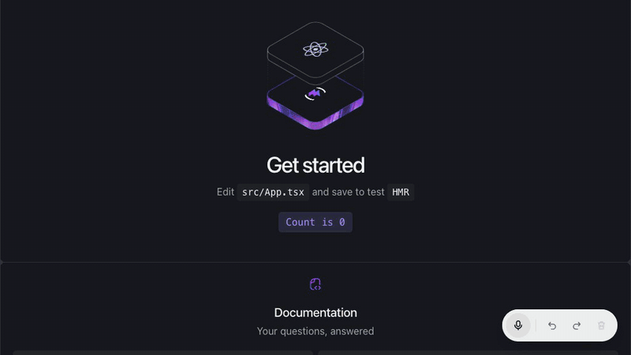

# Verbally

**Point at your app. Say the change. Watch the code change.**



<sub>Real speed, no cuts. Six phrases, six edits in `src/App.tsx`.</sub>

You look at a button and think "bigger, and not that blue". Now you just say it.

Hold `⌥` (`Alt` on Linux), point, talk. A few seconds later the change is in your source file. No prompt box. No "the third card in the second row, no, the other one".

## Get started

Paste this into Claude Code or Codex, in your project:

```
Install Verbally here and start it: https://raw.githubusercontent.com/azdaev/verbally/main/INSTALL.md
```

That is all. The agent installs it, starts it, and opens your app with a small bar in the corner.

## You need

- **Claude Code or Codex CLI**, signed in. Choose the engine in Settings → Model.
- **A Vite + React app.** Other stacks: [LIMITATIONS.md](LIMITATIONS.md).
- **Chrome**, **Node**, and **macOS or Linux**.

No API keys. If a dictation app runs already (Hex, Handy, Wispr Flow), it does the listening and Verbally takes its text. More in [docs/DETAILS.md](docs/DETAILS.md).

## Say things like

- "make this heading bigger"
- "this ① must look like that ②" (stop the mouse for a moment to drop a mark)
- "show me three versions of this card"
- `⌘Z` (`Ctrl+Z` on Linux), when it gets you wrong.

## Good to know

- **It uses your selected CLI login.** Claude Code and Codex CLI support subscription login.
- **It writes into your real files.** Commit first.
- **Claude Code runs with all tools allowed. Codex runs read-only.** Verbally applies the returned edits and records undo steps.
- **The gear on the bar** has the settings: who listens, the engine, the model, the keys.
- **No project yet?** `verbally` with no folder builds a new page from nothing, by voice.

Settings, security and the install by hand: [docs/DETAILS.md](docs/DETAILS.md). License: [MIT](LICENSE).
